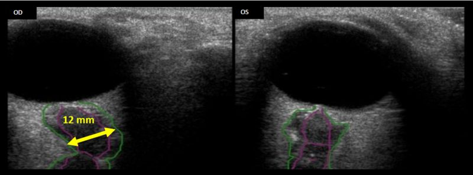

# Optic nerve sheath diameter
Region: Head and neck
Keywords: ONSD, intracranial pressure, raised ICP, papilloedema, ultrasound, presión intracraneal, vaina del nervio óptico

Width of the optic nerve sheath behind the globe as an indirect sign of raised intracranial pressure; transorbital ultrasound (also CT, MRI).

## How to measure

- Closed eyelid, linear probe, low output power.
- Measure 3 mm behind the globe, perpendicular to the nerve, across the outer borders of the sheath.
- Average two planes and both eyes.

## Values

| Patient | Suggests raised intracranial pressure |
|---|---|
| Adult | > 5 mm (cut-offs of 5–6 mm are in use) |
| Child 1–15 years | > 4.5 mm |
| Infant | > 4 mm |

A screening sign, not a pressure measurement.

## Source

Dubourg J et al. Ultrasonography of optic nerve sheath diameter for detection of raised intracranial pressure: a systematic review and meta-analysis. Intensive Care Med 2011;37:1059–1068.

Picture: "VIIP Figure 6.png" by NASA, Public domain, https://commons.wikimedia.org/wiki/File:VIIP_Figure_6.png (resized).
