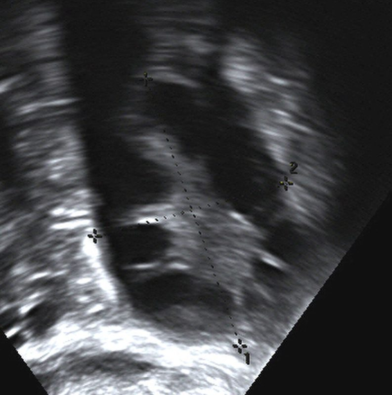

# Ovarian volume
Region: Pelvis
Keywords: ovary, polycystic ovary, PCOS, PCOM, ellipsoid, volumen ovárico, ovario poliquístico

Volume of the ovary on transvaginal ultrasound.

## How to measure

- Measure the greatest length and the depth perpendicular to it in one plane, and the width in the plane at right angles.
- Volume (ml) = length × width × depth (cm) × 0.523.
- Do not use an ovary that holds a dominant follicle (> 10 mm), a corpus luteum or a cyst.

## Values

| Finding | Volume |
|---|---|
| Reproductive age, upper limit | 20 ml |
| Postmenopausal, upper limit | 10 ml |
| Polycystic ovarian morphology | ≥ 10 ml, or 20 or more follicles of 2–9 mm in an ovary |

## Source

Pavlik EJ et al. Ovarian volume related to age. Gynecol Oncol 2000;77:410–412. Teede HJ et al. International evidence-based guideline for the assessment and management of polycystic ovary syndrome. Hum Reprod 2018;33:1602–1618.

Picture: "PCO polycystic ovary.jpg" by Je Hyuk Lee, CC BY-SA 3.0 / GFDL, https://commons.wikimedia.org/wiki/File:PCO_polycystic_ovary.jpg (resized).
