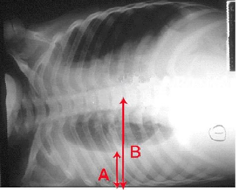

# Pleural effusion thickness on the decubitus view
Region: Chest
Keywords: pleural fluid, layering, thoracentesis, derrame pleural, decúbito lateral

Depth of free pleural fluid on a lateral decubitus chest radiograph, affected side down.

## How to measure

- Measure the thickness of the fluid layer between the inner chest wall and the lung edge, perpendicular to the chest wall.

## Values

| Finding | Meaning |
|---|---|
| Fluid layers along the dependent chest wall | Free (not loculated) effusion |
| Thickness > 10 mm | Enough fluid for a diagnostic thoracentesis |

The decubitus view shows as little as 5–10 ml of fluid; a lateral erect view needs about 50 ml and a PA view about 200 ml.

## Source

Light RW. Pleural effusion. N Engl J Med 2002;346:1971–1977.

Picture: "Pleural effusion.jpg" by InvictaHOG (en.wikipedia), Public domain, https://commons.wikimedia.org/wiki/File:Pleural_effusion.jpg (resized).
