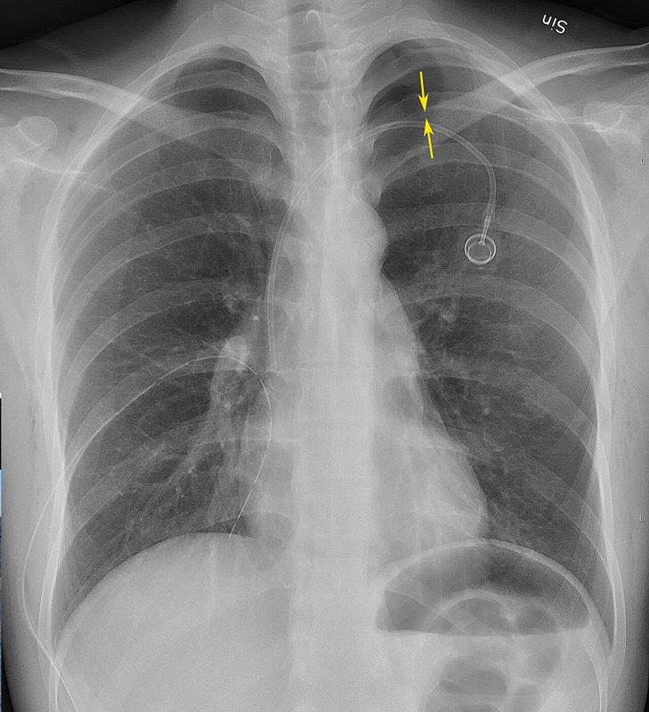

# Pneumothorax size (interpleural distance)
Region: Chest
Keywords: pneumothorax, apex, cupola, BTS, ACCP, neumotórax

Size of a pneumothorax on an erect chest radiograph, as the distance between the visceral pleural line and the chest wall.

## How to measure

- American College of Chest Physicians: distance from the lung apex to the cupola of the chest.
- British Thoracic Society (2010): distance from the pleural line to the chest wall at the level of the hilum.

## Values

| Guideline | Small | Large |
|---|---|---|
| ACCP 2001 (apex to cupola) | < 3 cm | ≥ 3 cm |
| BTS 2010 (level of the hilum) | < 2 cm | ≥ 2 cm (about half of the hemithorax volume) |

Symptoms weigh more than size in current guidance (BTS 2023): size mainly tells whether there is room to intervene safely.

## Source

Baumann MH et al. Management of spontaneous pneumothorax: an ACCP Delphi consensus statement. Chest 2001;119:590–602. MacDuff A et al. BTS pleural disease guideline 2010. Thorax 2010;65 Suppl 2:ii18–31.

Picture: "X-ray subtle pneumothorax in inspiration - annotated.jpg" by Mikael Häggström, CC0 1.0, https://commons.wikimedia.org/wiki/File:X-ray_subtle_pneumothorax_in_inspiration_-_annotated.jpg (resized).
