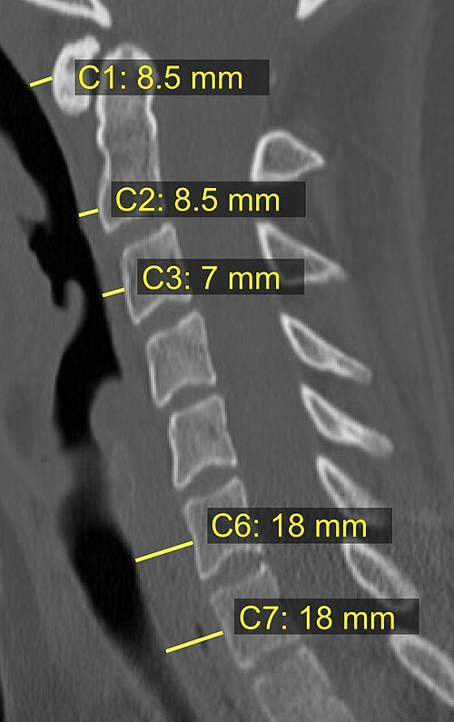

# Cervical prevertebral soft tissue thickness
Region: Spine
Keywords: retropharyngeal, retrotracheal, prevertebral swelling, haematoma, abscess, partes blandas prevertebrales

Thickness of the soft tissue in front of the cervical vertebrae; widening points to haematoma, oedema or abscess.

## How to measure

- Midsagittal CT (or a true lateral radiograph), neutral position, no swallowing.
- Measure from the anterior cortex of the vertebral body to the air column, perpendicular to the body.
- C4 and C5 are unreliable: the position of the oesophagus and larynx varies.

## Values

Upper limits in adults on CT (Rojas et al.):

| Level | Upper limit |
|---|---|
| C1 | 8.5 mm |
| C2 | 6 mm |
| C3 | 7 mm |
| C6 | 18 mm |
| C7 | 18 mm |

Radiograph rule of thumb: up to 7 mm at C2 and 22 mm at C6 in adults (14 mm at C6 in children).

The picture labels C2 with 8.5 mm; the published limit is 6 mm, as in the table.

## Source

Rojas CA et al. Normal thickness and appearance of the prevertebral soft tissues on multidetector CT. AJNR 2009;30:136–141.

Picture: "CT of prevertebral space.jpg" by Mikael Häggström, CC0 1.0, https://commons.wikimedia.org/wiki/File:CT_of_prevertebral_space.jpg (resized).
