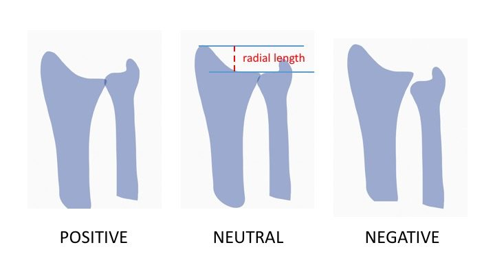

# Radial height and ulnar variance
Region: Wrist
Keywords: radial length, ulna plus, ulna minus, ulnar impaction, Kienböck, distal radius fracture, varianza cubital, altura radial

Relative lengths of radius and ulna on a PA radiograph of the wrist in neutral rotation (shoulder abducted 90°, elbow flexed 90°).

## How to measure

- Draw two lines perpendicular to the long axis of the radius: one at the tip of the radial styloid, one at the distal surface of the ulnar head.
- Radial height (length): distance between them.
- Ulnar variance: distance between the ulnar head line and a parallel line at the ulnar corner of the radial articular surface. Positive when the ulna is longer.

## Values

| Measurement | Value |
|---|---|
| Radial height, normal | 10–13 mm |
| Radial shortening usually accepted after a fracture | < 5 mm |
| Ulnar variance, usual | 0 to −2 mm |
| Positive variance | Risk of ulnar impaction |
| Negative variance | Associated with Kienböck disease |

Pronation and a clenched fist increase the variance; supination reduces it.

## Source

Medoff RJ. Hand Clin 2005;21:279–288. Palmer AK, Glisson RR, Werner FW. Ulnar variance determination. J Hand Surg Am 1982;7:376–379.

Picture: "Radial length and ulnar variance.jpg" by Iiibalesiii, CC BY-SA 4.0, https://commons.wikimedia.org/wiki/File:Radial_length_and_ulnar_variance.jpg (resized).
