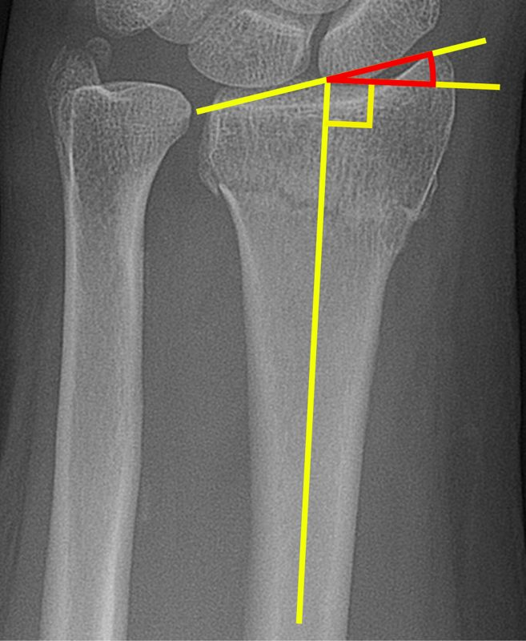

# Radial inclination
Region: Wrist
Keywords: radial angle, ulnar inclination, distal radius fracture, Colles, inclinación radial, fractura de radio distal

Slope of the distal articular surface of the radius on a PA radiograph of the wrist.

## How to measure

- Draw the long axis of the radius and a perpendicular to it at the ulnar corner of the articular surface.
- Draw a line from the tip of the radial styloid to the ulnar corner of the articular surface.
- The angle between that line and the perpendicular is the radial inclination.

## Values

| Finding | Angle |
|---|---|
| Normal | 21–25° (average 23°) |
| After a fracture, usually accepted | ≥ 15° |

## Source

Gartland JJ, Werley CW. Evaluation of healed Colles' fractures. J Bone Joint Surg Am 1951;33:895–907. Medoff RJ. Essential radiographic evaluation for distal radius fractures. Hand Clin 2005;21:279–288.

Picture: "Radial inclination of distal radius fracture.svg" by Mikael Häggström; original radiograph by Lucien Monfils, CC BY-SA 3.0 (also GFDL 1.2+), https://commons.wikimedia.org/wiki/File:Radial_inclination_of_distal_radius_fracture.svg (resized).
