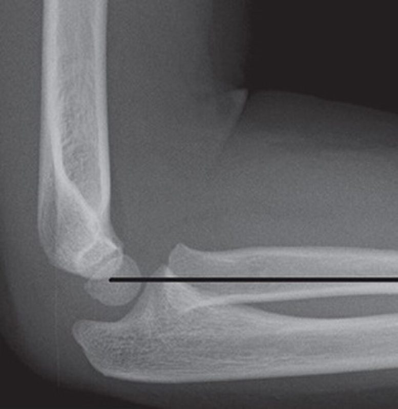

# Radiocapitellar line
Region: Elbow
Keywords: radial head dislocation, Monteggia, capitellum, paediatric elbow, luxación de la cabeza radial

Line that shows whether the radial head articulates with the capitellum, on every view of the elbow.

## How to measure

- Draw a line along the centre of the radial neck (not the shaft, which bows) and extend it through the joint.

## Values

| Finding | Meaning |
|---|---|
| Line through the capitellum on every view | Normal |
| Line misses the capitellum | Radial head dislocation; look for an ulnar fracture or bowing (Monteggia) |

In young children with a small or eccentric ossific nucleus the line can miss it in a normal elbow.

## Source

Storen G. Traumatic dislocation of the radial head as an isolated lesion in children. Acta Chir Scand 1959;116:144–147. Kunkel S et al. Limitations of the radiocapitellar line. J Pediatr Orthop 2011;31:628–632.

Picture: "Radiocapitellar line - normal.jpg" by Kilborn T, Moodley H, Mears S (S Afr J Radiol 2015); annotated by Mikael Häggström, CC BY-SA 4.0, https://commons.wikimedia.org/wiki/File:Radiocapitellar_line_-_normal.jpg (resized).
