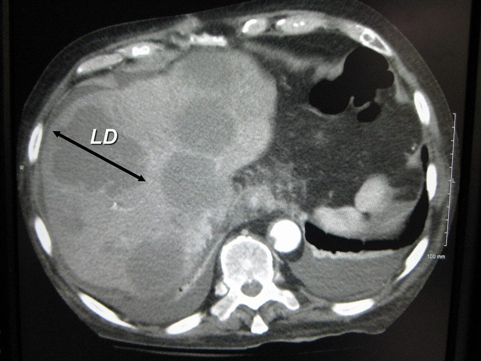

# RECIST 1.1 tumour measurement
Region: Oncology
Keywords: response evaluation, target lesion, sum of diameters, partial response, progressive disease, respuesta tumoral

Tumour burden and response to treatment on CT or MRI.

## How to measure

- Non-nodal lesion: longest diameter in the axial plane. Measurable when ≥ 10 mm (slice thickness up to 5 mm).
- Lymph node: short axis. Target when ≥ 15 mm; 10 to < 15 mm is pathological but non-target; < 10 mm is normal.
- Choose up to 5 target lesions, at most 2 per organ, and add their diameters (sum of diameters).
- At follow-up measure the same lesions in the same way, even when the longest diameter has turned.

## Values

| Response | Criterion |
|---|---|
| Complete response | All target lesions gone; every node < 10 mm short axis |
| Partial response | Sum decreases ≥ 30 % from baseline |
| Progressive disease | Sum increases ≥ 20 % from the smallest sum on study and by ≥ 5 mm, or a new lesion appears |
| Stable disease | Neither of the above |

## Source

Eisenhauer EA et al. New response evaluation criteria in solid tumours: revised RECIST guideline (version 1.1). Eur J Cancer 2009;45:228–247.

Picture: "MultipleLiverMets2008 LD.jpg" by David.Mirth (uploader), derived from File:MultipleLiverMets2008.jpg by James Heilman, MD (User:Jmh649), CC BY-SA 4.0, https://commons.wikimedia.org/wiki/File:MultipleLiverMets2008_LD.jpg (resized).
