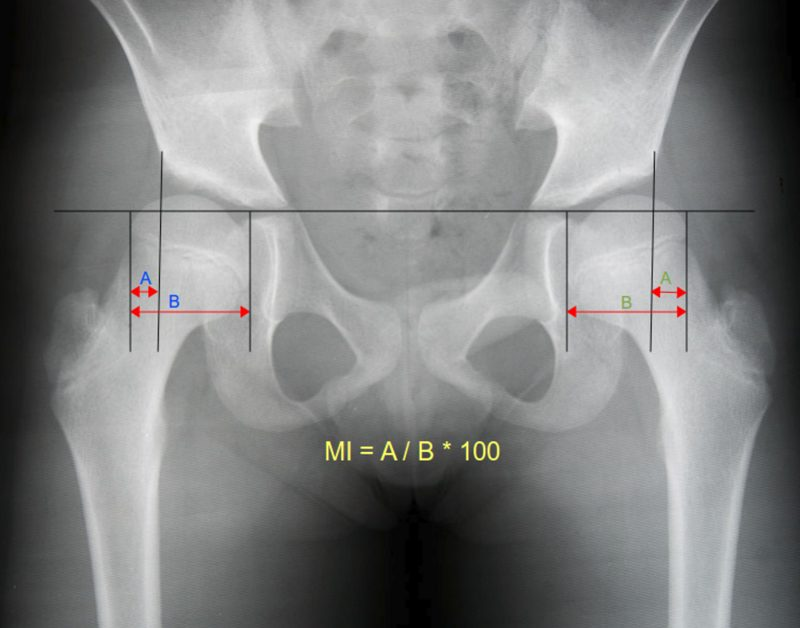

# Migration percentage (Reimers)
Region: Hip
Keywords: migration index, hip surveillance, cerebral palsy, subluxation, índice de Reimers, parálisis cerebral

Part of the femoral head that lies outside the acetabulum; hip surveillance in cerebral palsy, on an AP pelvis radiograph.

## How to measure

- Draw Hilgenreiner line and, perpendicular to it, Perkin line through the lateral edge of the acetabulum.
- A: width of the ossified femoral head lateral to Perkin line. B: whole width of the head, both parallel to Hilgenreiner line.
- Migration percentage = A / B × 100.
- Legs parallel, patellae forward: abduction and rotation change the value.

## Values

| Migration percentage | Meaning |
|---|---|
| < 10 % (up to 4 years: 0 %) | Normal |
| < 33 % | Within accepted limits |
| 33–50 % | Subluxation, hip at risk |
| > 50 % | Severe subluxation |
| 90–100 % | Dislocation |

A rise of more than about 7 percentage points per year is progression.

## Source

Reimers J. The stability of the hip in children. Acta Orthop Scand 1980;51 Suppl 184:1–100.

Picture: "Migrationsindex nach Reimers.png" by Login jetable; derivative by Hellerhoff, CC0 1.0, https://commons.wikimedia.org/wiki/File:Migrationsindex_nach_Reimers.png (resized).
