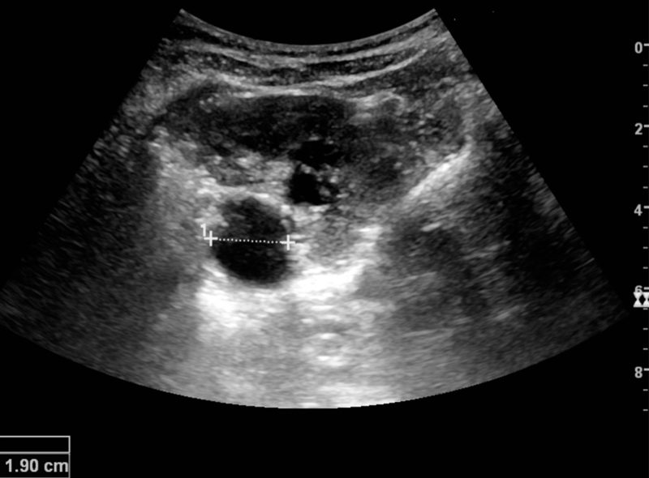

# Anteroposterior renal pelvis diameter
Region: Abdomen
Keywords: APRPD, hydronephrosis, pelviectasis, urinary tract dilation, UTD, antenatal, hidronefrosis, pelvis renal

Width of the renal pelvis in the child and the fetus, on a transverse ultrasound image of the kidney.

## How to measure

- Transverse plane through the renal hilum.
- Measure the greatest anteroposterior diameter of the pelvis inside the kidney (at the renal border, not the extrarenal part).

## Values

Urinary tract dilation (UTD) consensus:

| When | Normal | Dilated |
|---|---|---|
| Fetus, 16–27 weeks | < 4 mm | 4 to < 7 mm (A1), ≥ 7 mm (A2–3) |
| Fetus, 28 weeks or more | < 7 mm | 7 to < 10 mm (A1), ≥ 10 mm (A2–3) |
| After birth (older than 48 hours) | < 10 mm | 10 to < 15 mm (P1), ≥ 15 mm (P2 or more) |

Calyceal dilation, parenchymal thinning, ureter and bladder abnormalities raise the UTD grade whatever the diameter.

## Source

Nguyen HT et al. Multidisciplinary consensus on the classification of prenatal and postnatal urinary tract dilation (UTD classification system). J Pediatr Urol 2014;10:982–998.

Picture: "Ultrasonography of hydronephrosis with dilated anechoic pelvis and calyces, along with cortical atrophy - measurement.jpg" by Kristoffer Lindskov Hansen, Michael Bachmann Nielsen and Caroline Ewertsen, CC BY 4.0, https://commons.wikimedia.org/wiki/File:Ultrasonography_of_hydronephrosis_with_dilated_anechoic_pelvis_and_calyces,_along_with_cortical_atrophy_-_measurement.jpg (resized).
