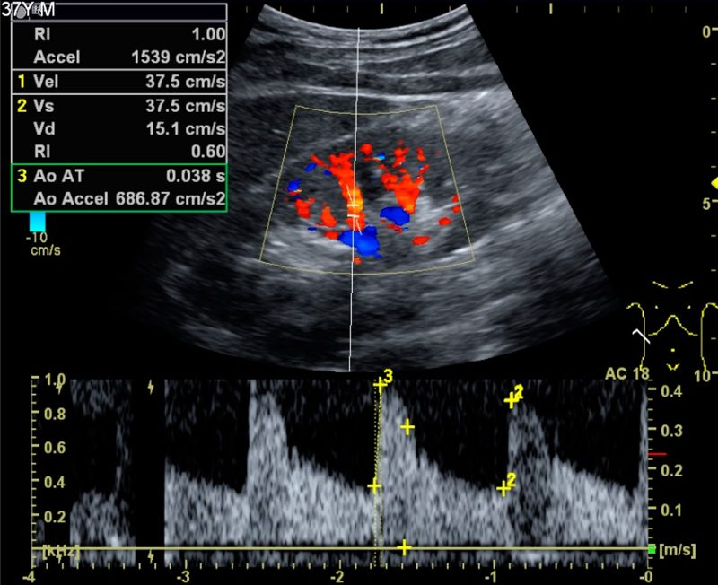

# Renal resistive index
Region: Abdomen
Keywords: RI, Pourcelot index, Doppler, interlobar artery, obstruction, transplant, índice de resistencia

Resistance to flow in the intrarenal arteries on spectral Doppler ultrasound.

## How to measure

- Sample an interlobar or arcuate artery (along the edge of a pyramid) with the smallest scale that avoids aliasing.
- Read the peak systolic velocity (PSV) and the end-diastolic velocity (EDV).
- RI = (PSV − EDV) / PSV. Average the upper, middle and lower thirds of the kidney.

## Values

| Finding | RI |
|---|---|
| Normal adult | < 0.70 |
| Raised (obstruction, parenchymal or vascular disease, transplant dysfunction) | > 0.70 |

Healthy infants and elderly people have higher values; so do a slow heart rate and breath-holding.

## Source

Tublin ME, Bude RO, Platt JF. The resistive index in renal Doppler sonography: where do we stand? AJR 2003;180:885–892.

Picture: "Doppler ultrasound of systolic velocity (Vs), diastolic velocity (Vd), acceleration time (AoAT), systolic acceleration (Ao Accel) and resistive index (RI) of normal kidney.jpg" by Kristoffer Lindskov Hansen, Michael Bachmann Nielsen and Caroline Ewertsen, CC BY 4.0, https://commons.wikimedia.org/wiki/File:Doppler_ultrasound_of_systolic_velocity_(Vs),_diastolic_velocity_(Vd),_acceleration_time_(AoAT),_systolic_acceleration_(Ao_Accel)_and_resistive_index_(RI)_of_normal_kidney.jpg (resized).
