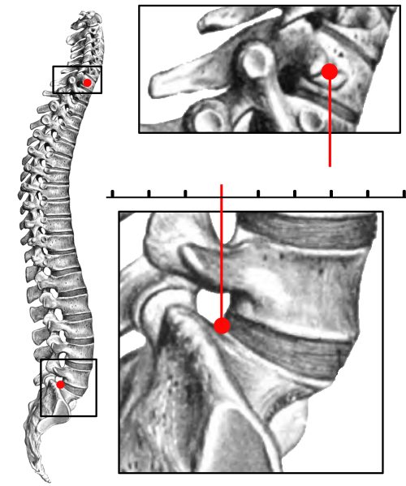

# Sagittal vertical axis (SVA)
Region: Spine
Keywords: sagittal balance, C7 plumb line, plomada, adult spinal deformity, balance sagital

Global sagittal balance on a standing lateral radiograph of the whole spine.

## How to measure

- Drop a vertical line from the centre of the C7 vertebral body.
- Measure its horizontal distance to the posterosuperior corner of S1.
- Positive when the plumb line falls in front of the corner.

## Values

SRS–Schwab modifier for adult spinal deformity:

| SVA | Grade |
|---|---|
| < 40 mm | 0 (normal) |
| 40–95 mm | + |
| > 95 mm | ++ |

## Source

Schwab F et al. Scoliosis Research Society–Schwab adult spinal deformity classification. Spine 2012;37:1077–1082.

Picture: "Sagittal balance.svg" by Mikael Häggström, CC0 1.0, https://commons.wikimedia.org/wiki/File:Sagittal_balance.svg (resized).
