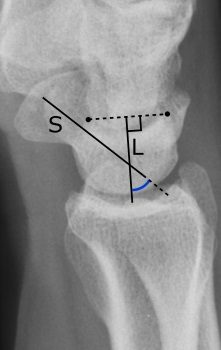

# Scapholunate angle
Region: Wrist
Keywords: SL angle, DISI, VISI, carpal instability, dorsal intercalated segment instability, inestabilidad carpiana, ángulo escafolunar

Angle between scaphoid and lunate on a true lateral radiograph of the wrist in neutral position.

## How to measure

- Scaphoid axis: line tangent to the volar surfaces of its proximal and distal poles.
- Lunate axis: perpendicular to the line joining the tips of its volar and dorsal horns.
- The angle between the two axes is the scapholunate angle.

## Values

| Finding | Angle |
|---|---|
| Volar intercalated segment instability (VISI) | < 30° |
| Normal | 30–60° |
| Borderline | 60–80° |
| Dorsal intercalated segment instability (DISI), scapholunate dissociation | > 80° (suspect above 60–70°) |

The capitolunate angle on the same image is normally below 30°.

## Source

Linscheid RL et al. Traumatic instability of the wrist. J Bone Joint Surg Am 1972;54:1612–1632. Gilula LA, Weeks PM. Post-traumatic ligamentous instabilities of the wrist. Radiology 1978;129:641–651.

Picture: "SL angle of the wrist.jpg" by Nevit Dilmen and Mikael Häggström, CC BY-SA 3.0, https://commons.wikimedia.org/wiki/File:SL_angle_of_the_wrist.jpg (resized).
