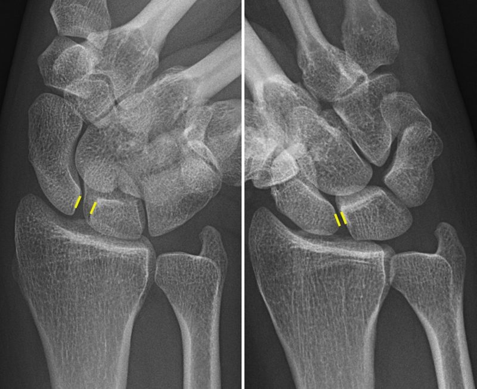

# Scapholunate interval
Region: Wrist
Keywords: SL gap, scapholunate dissociation, Terry Thomas sign, diastasis, ligament tear, disociación escafolunar

Width of the joint between scaphoid and lunate on a PA radiograph of the wrist.

## How to measure

- Measure the gap between the two bones at the middle of the joint, where their surfaces are parallel.
- Stress views (clenched fist, ulnar deviation) show a dynamic widening that neutral views hide.
- Compare with the other wrist.

## Values

| Finding | Interval |
|---|---|
| Normal | ≤ 2 mm |
| Suspicious | 2–4 mm, or wider than the other side |
| Scapholunate dissociation | > 4 mm |

## Source

Gilula LA, Weeks PM. Radiology 1978;129:641–651. Schimmerl-Metz SM et al. Radiologic measurement of the scapholunate joint. J Hand Surg Am 1999;24:1237–1244.

Picture: "X-ray of dynamic scapholunate instability - annotated.jpg" by Mikael Häggström, CC0 1.0, https://commons.wikimedia.org/wiki/File:X-ray_of_dynamic_scapholunate_instability_-_annotated.jpg (resized).
