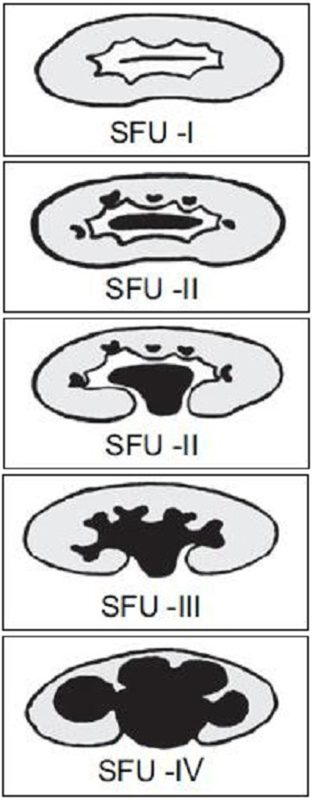

# Hydronephrosis grading (Society for Fetal Urology)
Region: Abdomen
Keywords: SFU, hydronephrosis, pelvicalyceal dilatation, calyces, hidronefrosis

Grade of dilatation of the collecting system on ultrasound in children.

## How to measure

- Look at the renal pelvis, the calyces and the parenchyma on longitudinal and transverse images, with the child hydrated and the bladder not overfilled.

## Values

| Grade | Finding |
|---|---|
| 0 | No dilatation |
| I | Renal pelvis slightly split |
| II | Pelvis dilated, a few calyces visible |
| III | Pelvis and all calyces dilated, normal parenchyma |
| IV | As III with thinned parenchyma |

## Source

Fernbach SK, Maizels M, Conway JJ. Ultrasound grading of hydronephrosis: introduction to the system used by the Society for Fetal Urology. Pediatr Radiol 1993;23:478–480.

Picture: "Society for Fetal Urology (SFU) grading of hydronephrosis.jpg" by Jose de Bessa Jr, Cicilia M. Rodrigues, Maria Cristina Chammas,Eduardo P. Miranda, Cristiano M. Gomes, Paulo R. Moscardi,Marcia C. Bessa, Carlos A. Molina, Rica, CC BY 4.0, https://commons.wikimedia.org/wiki/File:Society_for_Fetal_Urology_(SFU)_grading_of_hydronephrosis.jpg (resized).
