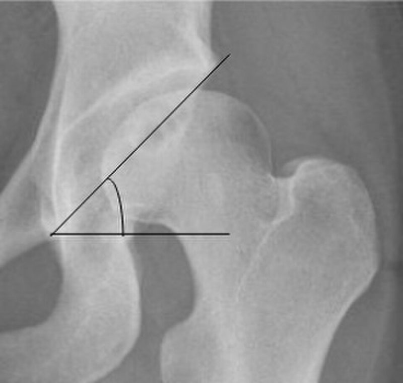

# Sharp angle (acetabular angle)
Region: Hip
Keywords: acetabular inclination, dysplasia, teardrop, ángulo de Sharp

Inclination of the acetabular opening in the adult, on an AP pelvis radiograph.

## How to measure

- Draw the horizontal line through the lower ends of both teardrops.
- Draw a line from the lower end of the teardrop to the lateral edge of the acetabular roof.
- The angle between them is the Sharp angle.

## Values

| Finding | Angle |
|---|---|
| Normal | 33–38° |
| Upper normal | 39–42° |
| Dysplasia | > 42° |

## Source

Sharp IK. Acetabular dysplasia: the acetabular angle. J Bone Joint Surg Br 1961;43:268–272.

Picture: "Sharp angle of the hip.jpg" by Ruiz Santiago F, Santiago Chinchilla A, Ansari A, Guzmán Álvarez L, Castellano García MM, Martínez Martínez A, Tercedor Sánchez J (Radiol Res Pract 2016, doi:10.1155/2016/6369237); uploaded by Mikael Häggström, CC BY 4.0, https://commons.wikimedia.org/wiki/File:Sharp_angle_of_the_hip.jpg (resized).
