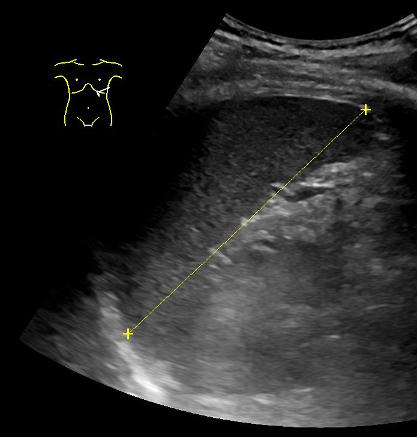

# Spleen length
Region: Abdomen
Keywords: splenomegaly, splenic size, esplenomegalia, bazo

Greatest length of the spleen on ultrasound (coronal plane through the hilum) or on coronal CT.

## How to measure

- Measure the longest distance between the two poles (dome to tip), in the plane that shows the hilum.

## Values

| Finding | Length in adults |
|---|---|
| Normal | < 12 cm (up to 13 cm in tall people) |
| Splenomegaly | > 12–13 cm |
| Massive splenomegaly | > 20 cm |

Length follows body height and is larger in men.

## Source

Niederau C et al. Sonographic measurements of the normal liver, spleen, pancreas, and portal vein. Radiology 1983;149:537–540.

Picture: "Maximum length of spleen on ultrasonography.jpg" by Mikael Häggström, CC0 1.0, https://commons.wikimedia.org/wiki/File:Maximum_length_of_spleen_on_ultrasonography.jpg (resized).
