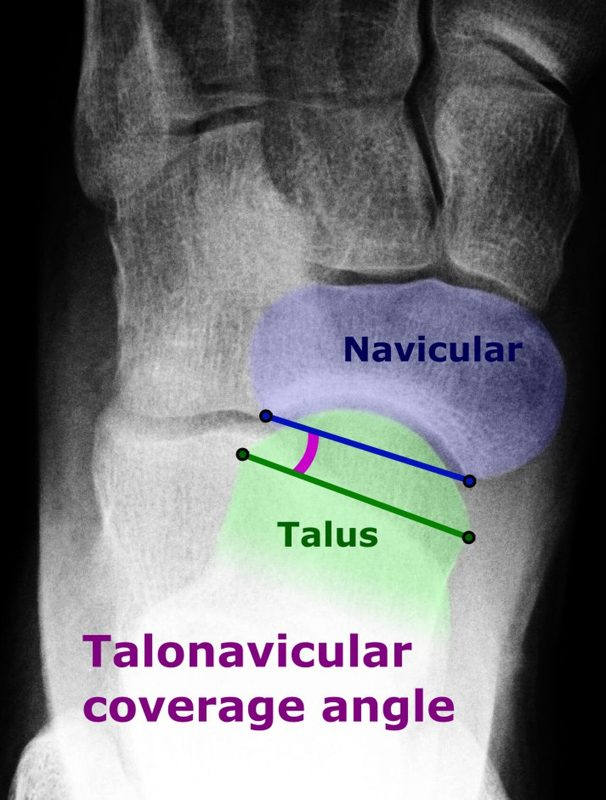

# Talonavicular coverage angle
Region: Foot and ankle
Keywords: flatfoot, pes planus, forefoot abduction, talar head uncoverage, pie plano

Lateral shift of the navicular on the talar head, on a weight-bearing dorsoplantar radiograph of the foot.

## How to measure

- Draw a line joining the medial and lateral edges of the articular surface of the talar head.
- Draw a line joining the edges of the articular surface of the navicular.
- The angle between the two lines (or between their perpendiculars) is the coverage angle.

## Values

| Finding | Angle |
|---|---|
| Normal | < 7° |
| Lateral subluxation of the navicular (forefoot abduction, flatfoot) | > 7° |

## Source

Sangeorzan BJ et al. Effect of calcaneal lengthening on relationships among the hindfoot, midfoot, and forefoot. Foot Ankle 1993;14:136–141.

Picture: "Talonavicular coverage angle.jpg" by Mikael Häggström and Andrew Magill, CC BY-SA 4.0, https://commons.wikimedia.org/wiki/File:Talonavicular_coverage_angle.jpg (resized).
