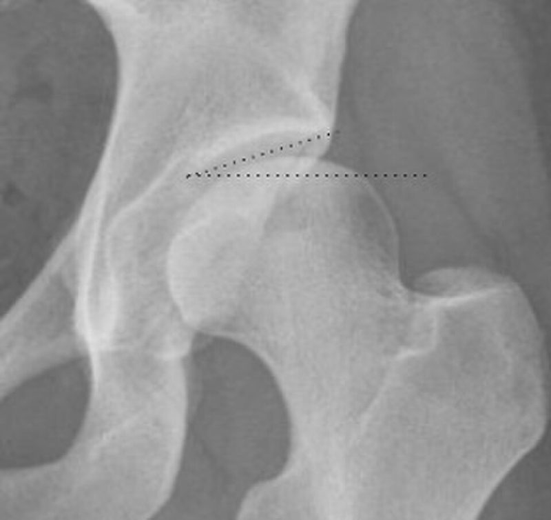

# Tönnis angle (acetabular roof angle)
Region: Hip
Keywords: acetabular index of the weight-bearing zone, sourcil, roof obliquity, dysplasia, ángulo de Tönnis

Slope of the weight-bearing acetabular roof (sourcil) in the adult, on an AP pelvis radiograph.

## How to measure

- Draw a horizontal line (parallel to the inter-teardrop line) through the medial end of the sourcil.
- Draw a line from the medial end to the lateral end of the sourcil.
- The angle between them is the Tönnis angle.

## Values

| Finding | Angle |
|---|---|
| Normal | 0–10° |
| Dysplasia, risk of instability | > 10° |
| Overcoverage (pincer) | < 0° |

## Source

Tönnis D. Congenital dysplasia and dislocation of the hip in children and adults. Springer, 1987.

Picture: "Tönnis angle of the hip.jpg" by Ruiz Santiago F, Santiago Chinchilla A, Ansari A, Guzmán Álvarez L, Castellano García MM, Martínez Martínez A, Tercedor Sánchez J (Radiol Res Pract 2016, doi:10.1155/2016/6369237); uploaded by Mikael Häggström, CC BY 4.0, https://commons.wikimedia.org/wiki/File:T%C3%B6nnis_angle_of_the_hip.jpg (resized).
