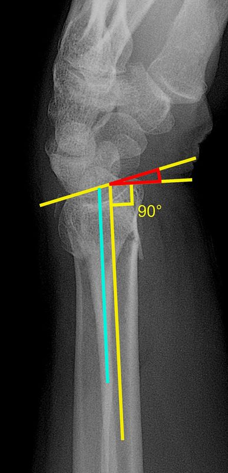

# Volar (palmar) tilt of the distal radius
Region: Wrist
Keywords: palmar inclination, dorsal tilt, dorsal angulation, distal radius fracture, Colles, Smith, inclinación volar

Tilt of the distal articular surface of the radius on a true lateral radiograph of the wrist.

## How to measure

- Draw the long axis of the radius and a perpendicular to it.
- Draw a line joining the dorsal and volar rims of the articular surface.
- The angle between that line and the perpendicular is the tilt: volar when the surface faces the palm, dorsal when it faces the back of the hand.

## Values

| Finding | Tilt |
|---|---|
| Normal | 11° volar on average (2–20°) |
| After a fracture, usually accepted | No more than neutral to 10° dorsal |

## Source

Gartland JJ, Werley CW. J Bone Joint Surg Am 1951;33:895–907. Medoff RJ. Hand Clin 2005;21:279–288.

Picture: "Dorsal tilt of distal radius fracture.jpg" by Mikael Häggström; original radiograph by Lucien Monfils, CC BY-SA 3.0 (also GFDL 1.2+), https://commons.wikimedia.org/wiki/File:Dorsal_tilt_of_distal_radius_fracture.jpg (resized).
